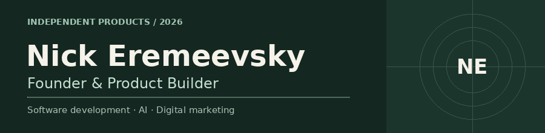
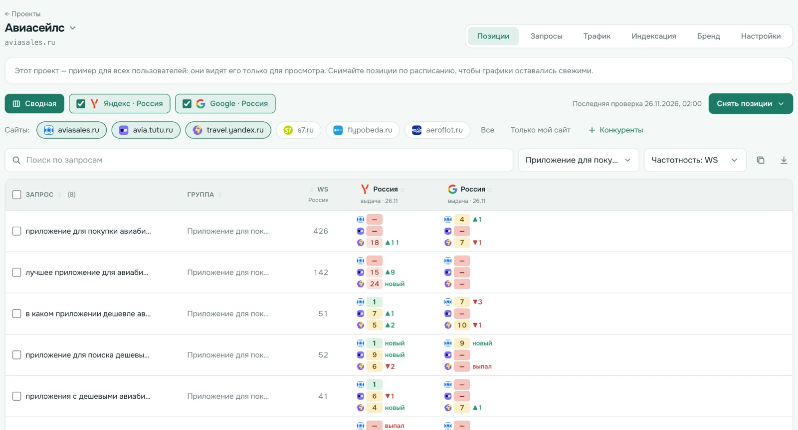
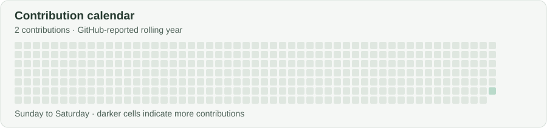
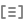

<!-- Profile README — based on the V18 personal website, 2026-11-27. -->

  

# Nick Eremeevsky

**Founder & Product Builder** · Software development · AI · Digital marketing

I build independent digital products at the intersection of software development, AI, and digital marketing. I'm the founder of **[Keywordly.top](https://keywordly.top/)** and I'm developing **[WorldBible.app](https://worldbible.app/)**.

## Independent products

###  [Keywordly.top](https://keywordly.top/)

**Founder · B2B SaaS · Current project**

A platform for tracking search rankings and brand mentions in search and AI-generated results. Its interface includes rank tracking, keyword organization, brand monitoring, and service status.

Explore Keywordly — more screenshots

| Keyword groups | Brand monitoring |
| :---: | :---: |
|  |  |

Demo data; Russian-language interface. These screenshots are not a live service integration.

### [WorldBible.app](https://worldbible.app/)

**In development**

A multilingual application for reading and studying the Bible. Check the project website for its launch status.

## Now

- Developing Keywordly.top.
- Preparing WorldBible.app for launch.
- Building my personal brand and independent products.

## Tech stack

Technologies and tools I work with, including AI-assisted development.

### Frontend

       

HTML5 · CSS3 · JavaScript · TypeScript · React · Next.js · shadcn/ui · Zustand

### Backend & APIs

        

Python · Node.js · FastAPI · PHP · SQLAlchemy · Prisma · REST API · Telegram Bot API · Aiogram

### Databases

  

PostgreSQL · MySQL · SQLite

### Infrastructure & tools

         

Git · GitHub · Docker · Linux · GitHub Actions · VS Code · Playwright · pnpm · S3 · Bash

### AI & data processing

      

OpenAI API · ChatGPT · DeepSeek · Grok · Beautiful Soup · Selenium · Pandas

### CMS

  

WordPress · 1C-Bitrix · Strapi

## GitHub activity

Language breakdown is based on GitHub-reported code bytes in public, non-fork, non-archived repositories owned by this account; it is not a measure of proficiency. The calendar uses GitHub's aggregate contribution data, which may include anonymized private contributions depending on profile visibility. See [my GitHub activity](https://github.com/nickeremeevsky?tab=overview).

## Professional journey

| Period | Role | Organization / focus |
| :--- | :--- | :--- |
| 2026 | Founder & Product Builder | Keywordly.top, WorldBible.app — independent products |
| 2024–2026 | Senior SEO Specialist, Staff Expert | [HighTime Agency](https://hightime.agency/) — international IT and technology projects |
| 2023–2024 | Freelance Web Developer | [bservice.shop](https://bservice.shop/), [cityswan.ru](https://cityswan.ru/) |
| 2022–2023 | Junior SEO Specialist | Citrus Soft — Russian projects |

<strong>Marketing stack — 14 tools</strong>

### SEO, GEO & AEO

       

Ahrefs · Google Search Console · Yandex Webmaster · Yandex Wordstat · Bing Webmaster Tools · PageSpeed Insights · Schema.org · IndexNow

### Advertising

 

Yandex Direct · Google Ads

### Analytics

   

Google Analytics · Yandex Metrica · DataLens · Matomo

## Webinars

Selected HighTime Agency webinars on B2B IT marketing and AI search. The events below are organized by HighTime Agency; no speaking role is claimed.

| Date | Topic |
| :--- | :--- |
| 2026-07-23 | [PR and brand awareness for B2B IT products](https://hightime.agency/events/) |
| 2026-05-21 | [IT product marketing through industry media](https://hightime.agency/activities/mql-for-tech) |
| 2026-02-05 | [AI search marketing for IT companies (GEO)](https://hightime.agency/activities/ai-marketing-v-it-tech) |

Upcoming webinars

- 2027-04-22 — Content marketing for IT companies.
- 2027-06-24 — IT product marketing through industry media.

[Event details](https://hightime.agency/events/). Dates and programme may change.

## Recommendations

Professional recommendations are planned for my [personal website](https://nickeremeevsky.com/en/).

## Beyond work

- **Education:** Oil and Gas Engineering (21.03.01), Vorkuta branch of Ukhta State Technical University, 2017–2020. Bachelor's studies (degree not completed).
- **Languages:** Russian (native), English (B2 — Upper-Intermediate).
- **Music:** Seven years of music school, accordion. I enjoy instrumental music.
- **Cycling:** Aventon Cordoba.

## Get in touch

For collaboration and independent project inquiries: **[hello@nickeremeevsky.com](mailto:hello@nickeremeevsky.com)** or [@nickeremeevsky on Telegram](https://t.me/nickeremeevsky).

More about my work and projects: [nickeremeevsky.com](https://nickeremeevsky.com/en/).

Technology marks belong to their respective owners. [Asset sources and notes](assets/tech/SOURCES.md).
