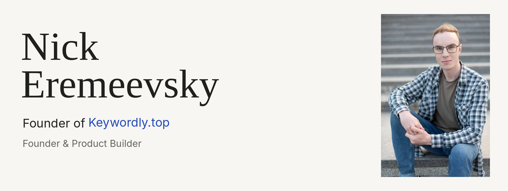
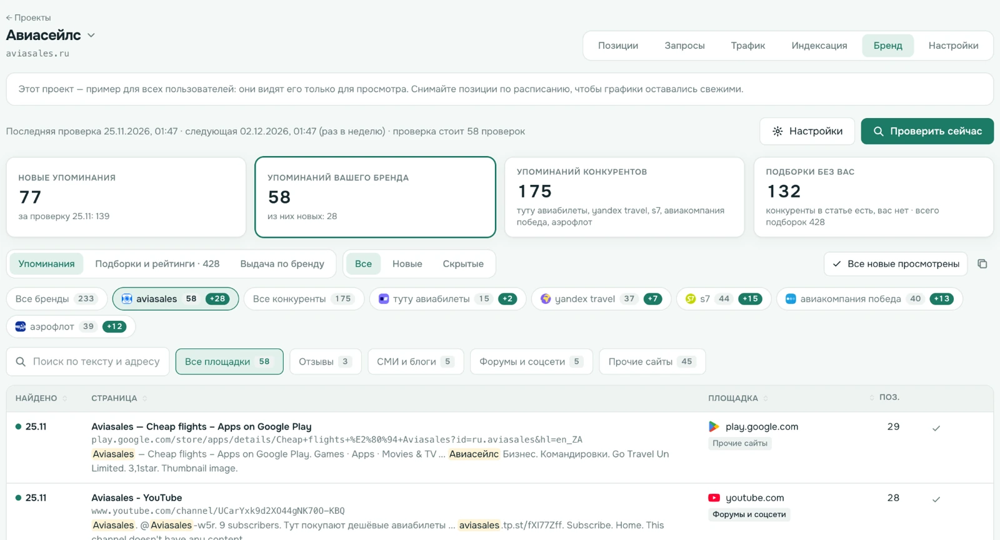
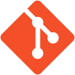
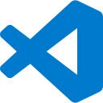

<!-- Editorial profile, adapted from the V18 personal website. -->
<picture>
  <source media="(prefers-color-scheme: dark)" srcset="assets/hero-dark.png">
  
</picture>

[Website ↗](https://nickeremeevsky.com/en/) &nbsp;·&nbsp; [LinkedIn ↗](https://www.linkedin.com/in/nickeremeevsky/) &nbsp;·&nbsp; [Telegram ↗](https://t.me/nickeremeevsky) &nbsp;·&nbsp; [X ↗](https://x.com/nickeremeevsky) &nbsp;·&nbsp; [Email ↗](mailto:hello@nickeremeevsky.com)

 

### Independent projects

 &nbsp;**[Keywordly.top ↗](https://keywordly.top/)**

Founder · Current project

A B2B SaaS platform for tracking search rankings and brand mentions in search and AI-generated results.

Rank tracking · Demo data, Russian-language interface.

Explore Keywordly

 
 
 

 
Keyword groups · Brand monitoring · Service status. Demo interface.

 

**[WorldBible.app ↗](https://worldbible.app/)**

In development

A multilingual application for reading and studying the Bible.

 

### Now

Developing Keywordly.top. Preparing WorldBible.app for launch. Building my personal brand and independent products.

 

### Professional journey

2022–2023  
**Citrus Soft**  
Junior SEO Specialist · Russian projects

2023–2024  
**Freelance**  
Web Developer · [bservice.shop](https://bservice.shop/), [cityswan.ru](https://cityswan.ru/)

2024–2026  
**[HighTime Agency ↗](https://hightime.agency/)**  
Senior SEO Specialist, Staff Expert · International IT and technology projects

2026  
**Independent products**  
[Keywordly.top](https://keywordly.top/), [WorldBible.app](https://worldbible.app/) · Product development and personal brand

 

### Tech stack

**Frontend**

&nbsp;HTML5 &nbsp;·&nbsp; &nbsp;CSS3 &nbsp;·&nbsp; &nbsp;JavaScript &nbsp;·&nbsp; &nbsp;TypeScript

&nbsp;React &nbsp;·&nbsp; &nbsp;Next.js &nbsp;·&nbsp; &nbsp;shadcn/ui

**Backend & APIs**

&nbsp;Python &nbsp;·&nbsp; &nbsp;Node.js &nbsp;·&nbsp; &nbsp;FastAPI &nbsp;·&nbsp; &nbsp;PHP

&nbsp;SQLAlchemy &nbsp;·&nbsp; &nbsp;Prisma &nbsp;·&nbsp; &nbsp;Telegram Bot API

**Databases**

&nbsp;PostgreSQL &nbsp;·&nbsp; &nbsp;MySQL &nbsp;·&nbsp; &nbsp;SQLite

**Infrastructure & tools**

&nbsp;Git &nbsp;·&nbsp; &nbsp;GitHub &nbsp;·&nbsp; &nbsp;Docker &nbsp;·&nbsp; &nbsp;Linux

&nbsp;GitHub Actions &nbsp;·&nbsp; &nbsp;VS Code &nbsp;·&nbsp; &nbsp;Playwright &nbsp;·&nbsp; &nbsp;pnpm

&nbsp;S3 &nbsp;·&nbsp; &nbsp;Bash

**AI & data processing**

&nbsp;OpenAI API &nbsp;·&nbsp; &nbsp;ChatGPT &nbsp;·&nbsp; &nbsp;DeepSeek &nbsp;·&nbsp; &nbsp;Grok

&nbsp;Selenium &nbsp;·&nbsp; &nbsp;Pandas

**CMS**

&nbsp;WordPress &nbsp;·&nbsp; &nbsp;Strapi

Marketing stack

**SEO, GEO & AEO**

&nbsp;Ahrefs &nbsp;·&nbsp; &nbsp;Google Search Console &nbsp;·&nbsp; &nbsp;Yandex Webmaster &nbsp;·&nbsp; &nbsp;Yandex Wordstat

&nbsp;Bing Webmaster Tools &nbsp;·&nbsp; &nbsp;PageSpeed Insights

**Advertising**

&nbsp;Yandex Direct &nbsp;·&nbsp; &nbsp;Google Ads

**Analytics**

&nbsp;Google Analytics &nbsp;·&nbsp; &nbsp;Yandex Metrica &nbsp;·&nbsp; &nbsp;DataLens &nbsp;·&nbsp; &nbsp;Matomo

 

### GitHub activity

<picture>
  <source media="(prefers-color-scheme: dark)" srcset="assets/stats/languages-dark.svg">
  
</picture>

<picture>
  <source media="(prefers-color-scheme: dark)" srcset="assets/stats/contributions-dark.svg">
  
</picture>

Language breakdown uses public repository code bytes, not proficiency. Contribution totals follow GitHub profile visibility.

 

### Webinars

21 May 2026

**Продвижение ИТ‑продуктов на отраслевых СМИ: как за 3 месяца завалить отдел продаж заявками через статьи на TAdviser, Бизнес Секретах, Habr и CNews**

5 February 2026

**Продвижение ИТ-компаний в нейросетях (GEO): Разбираем метод покрытия поисковых слоёв, чтобы ChatGPT, Perplexity**

 

### Education

2017–2020  
**Ukhta State Technical University · Vorkuta branch**  
Oil and Gas Engineering (21.03.01)  
Bachelor’s studies (degree not completed)

### Languages

Russian — Native  
English — B2 (Upper-Intermediate)

### Interests

**Music** — Seven years of music school, accordion. Instrumental music.  
**Cycling** — Aventon Cordoba.

 

### Get in touch

For collaboration and independent project inquiries, contact me directly.

[hello@nickeremeevsky.com ↗](mailto:hello@nickeremeevsky.com)  
[Telegram ↗](https://t.me/nickeremeevsky) &nbsp;·&nbsp; [Instagram ↗](https://www.instagram.com/nickeremeevsky/) &nbsp;·&nbsp; [nickeremeevsky.com ↗](https://nickeremeevsky.com/en/)

[Technology asset sources](assets/tech/SOURCES.md). Marks belong to their respective owners.
