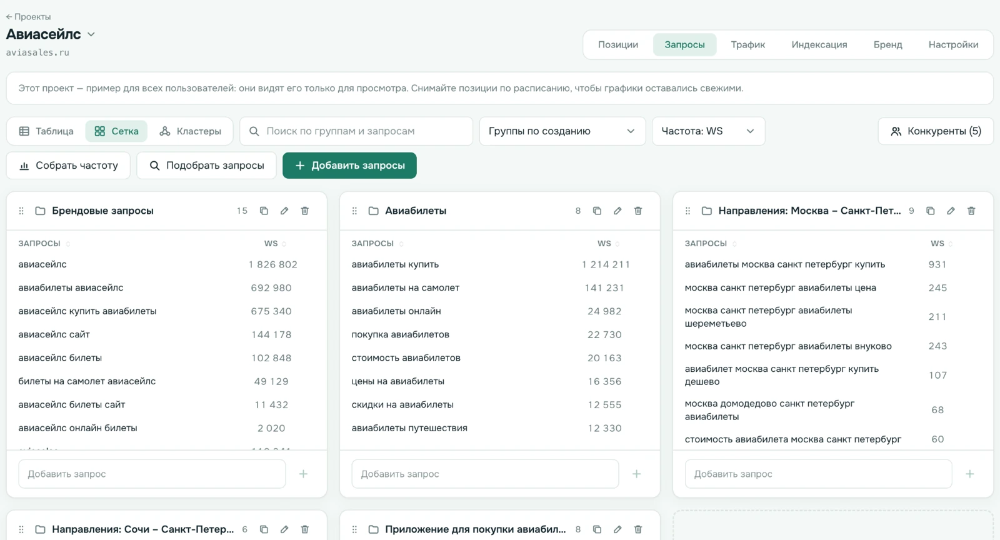
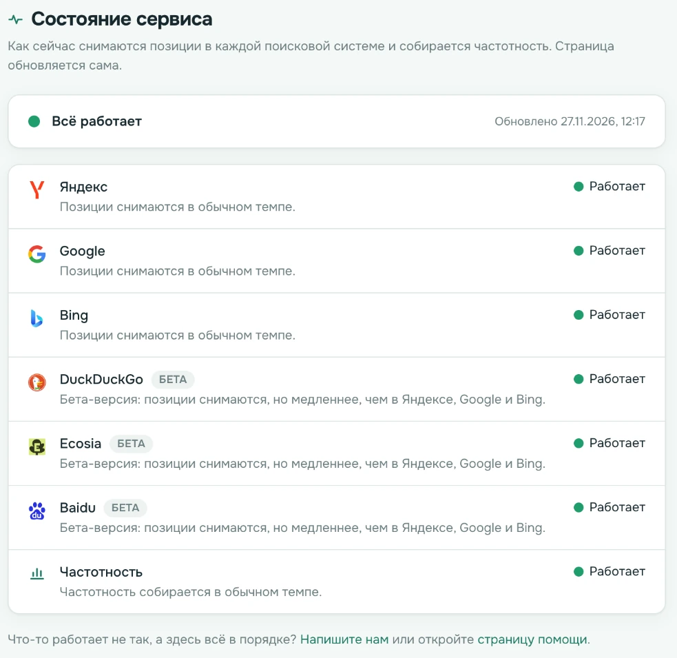
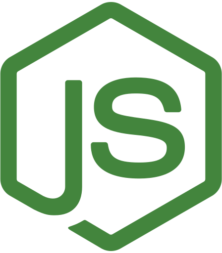
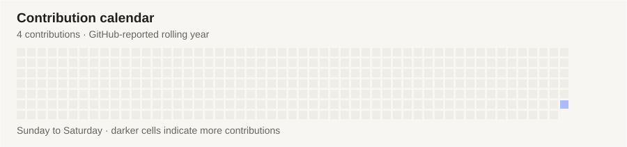
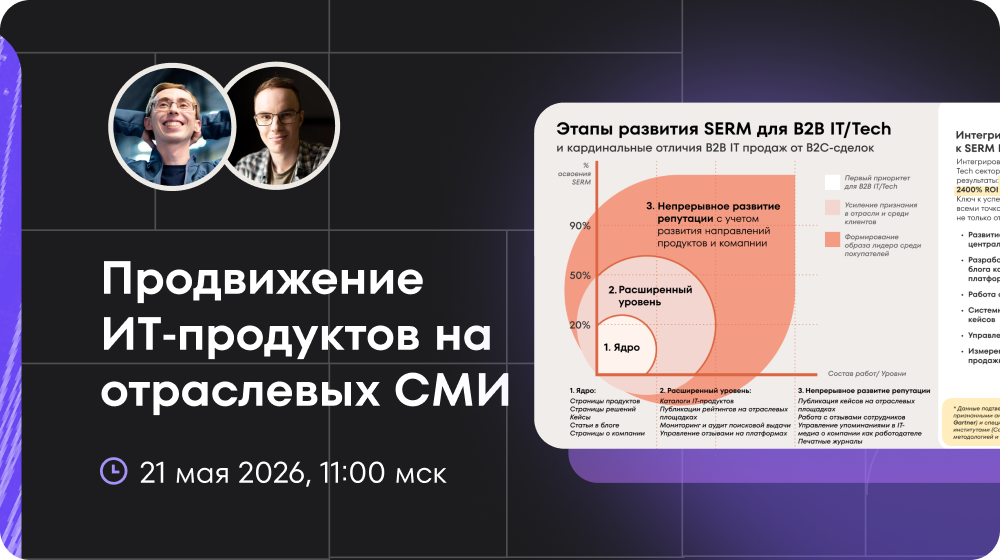
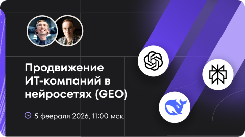

<!-- Local brand assets and generated statistics. Asset sources: assets/tech/SOURCES.md. -->

SEARCH / AI / SOFTWARE

# Building independent products.

Working at the intersection of search marketing, artificial intelligence and software development.

[Website ↗](https://nickeremeevsky.com/en/) · [LinkedIn ↗](https://www.linkedin.com/in/nickeremeevsky/) · [Telegram ↗](https://t.me/nickeremeevsky) · [X ↗](https://x.com/nickeremeevsky) · [Instagram ↗](https://www.instagram.com/nickeremeevsky/) · [Email ↗](mailto:hello@nickeremeevsky.com)

### 01 / Independent projects

<table>
  <tr>
    <td width="50%" valign="top">
       <strong><a href="https://keywordly.top/">Keywordly.top ↗</a></strong> 
      Founder · Current project
      
A B2B SaaS platform for tracking search rankings and brand mentions in search and AI-generated results.

    </td>
    <td width="50%" valign="top">
      <strong><a href="https://worldbible.app/">WorldBible.app ↗</a></strong> 
      In development
      
A multilingual application for reading and studying the Bible.

    </td>
  </tr>
</table>

Explore Keywordly — product interface

 

Demo data · Russian-language interface.

### 02 / Professional journey

| Period | Experience |
| :--- | :--- |
| 2026 | **Independent products** — [Keywordly.top](https://keywordly.top/), [WorldBible.app](https://worldbible.app/) · Product development and personal brand |
| 2024–2026 | **[HighTime Agency ↗](https://hightime.agency/)** — Senior SEO Specialist, Staff Expert · International IT and technology projects |
| 2023–2024 | **Freelance** — Web Developer · [bservice.shop](https://bservice.shop/), [cityswan.ru](https://cityswan.ru/) |
| 2022–2023 | **Citrus Soft** — Junior SEO Specialist · Russian projects |

### 03 / Tech stack

| Area | Tools |
| :--- | :--- |
| **Frontend** | &nbsp;HTML5 · &nbsp;CSS3 · &nbsp;JavaScript · &nbsp;TypeScript · &nbsp;React · &nbsp;Next.js · &nbsp;shadcn/ui |
| **Backend & APIs** | &nbsp;Python · &nbsp;Node.js · &nbsp;FastAPI · &nbsp;PHP · &nbsp;SQLAlchemy · &nbsp;Prisma · &nbsp;Telegram Bot API |
| **Databases** | &nbsp;PostgreSQL · &nbsp;MySQL · &nbsp;SQLite |
| **Infrastructure & tools** | &nbsp;Git · &nbsp;GitHub · &nbsp;Docker · &nbsp;Linux · &nbsp;GitHub Actions · &nbsp;VS Code · &nbsp;Playwright · &nbsp;pnpm · &nbsp;S3 · &nbsp;Bash |
| **AI & data processing** | &nbsp;OpenAI API · &nbsp;ChatGPT · &nbsp;DeepSeek · &nbsp;Grok · &nbsp;Selenium · &nbsp;Pandas |
| **CMS** | &nbsp;WordPress · &nbsp;Strapi |

### 04 / Marketing stack

| Area | Tools |
| :--- | :--- |
| **SEO, GEO & AEO** | &nbsp;Ahrefs · &nbsp;Google Search Console · &nbsp;Yandex Webmaster · &nbsp;Yandex Wordstat · &nbsp;Bing Webmaster Tools · &nbsp;PageSpeed Insights |
| **Advertising** | &nbsp;Yandex Direct · &nbsp;Google Ads |
| **Analytics** | &nbsp;Google Analytics · &nbsp;Yandex Metrica · &nbsp;DataLens · &nbsp;Matomo |

### 05 / GitHub activity

<picture>
  <source media="(prefers-color-scheme: dark)" srcset="assets/stats/contributions-dark.svg">
  
</picture>

Language breakdown · Public repositories

<picture>
  <source media="(prefers-color-scheme: dark)" srcset="assets/stats/languages-dark.svg">
  
</picture>

Code bytes in public, owned, non-fork, non-archived repositories, not proficiency. Private repositories are excluded.

Contribution totals follow GitHub profile visibility.

### 06 / Webinars

<table>
  <tr>
    <td width="250"></td>
    <td>21 May 2026 <strong>Продвижение ИТ‑продуктов на отраслевых СМИ: как за 3 месяца завалить отдел продаж заявками через статьи на TAdviser, Бизнес Секретах, Habr и CNews</strong></td>
  </tr>
  <tr>
    <td width="250"></td>
    <td>5 February 2026 <strong>Продвижение ИТ-компаний в нейросетях (GEO): Разбираем метод покрытия поисковых слоёв, чтобы ChatGPT, Perplexity</strong></td>
  </tr>
</table>

### 07 / Background

**Education** — Ukhta State Technical University · Vorkuta branch (2017–2020). Oil and Gas Engineering (21.03.01), bachelor’s studies (degree not completed).

**Languages** — Russian (native) · English (B2, Upper-Intermediate).

**Interests** — Music (seven years of music school, accordion, instrumental music) · Cycling (Aventon Cordoba).
